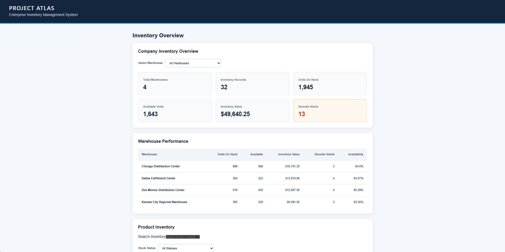
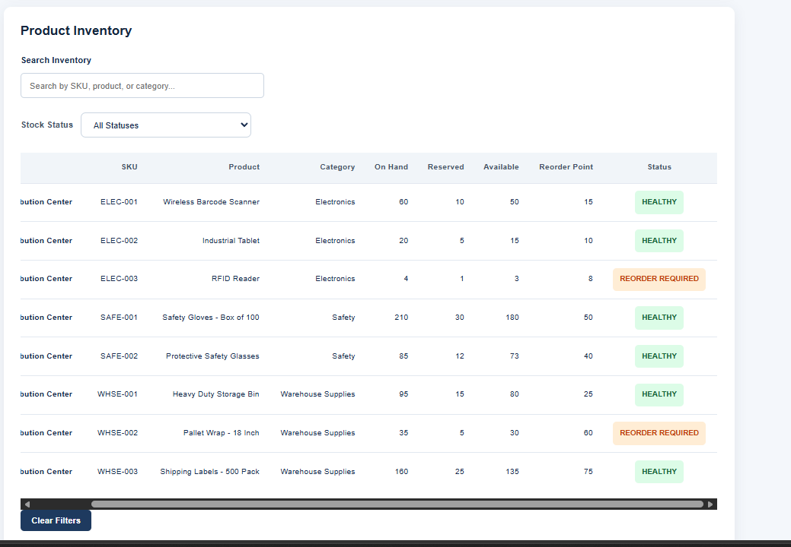
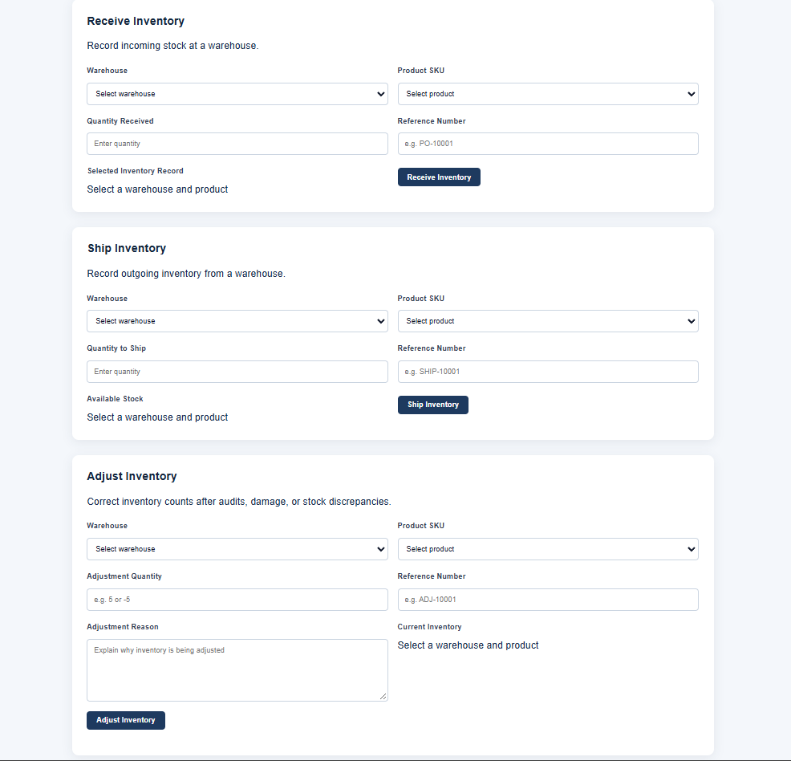
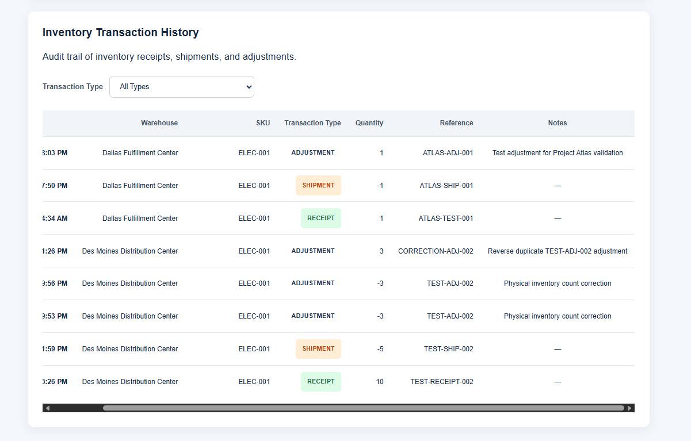

# Project Atlas

### Enterprise Inventory Management System

Project Atlas is a full-stack inventory management application built to demonstrate enterprise software engineering, database development, API design, and modern frontend development.

## Application Preview

Project Atlas provides a centralized dashboard for
monitoring inventory across multiple warehouses.



The dashboard displays real-time inventory metrics,
warehouse performance, inventory valuation, and
reorder alerts.

### Inventory Management

Project Atlas supports warehouse-specific inventory filtering,
product searches, stock availability tracking, and automated
reorder alerts.



Inventory records display quantities on hand, reserved stock,
available units, reorder points, and stock status.

### Inventory Transaction Processing

Project Atlas supports three inventory operations:
receiving stock, shipping stock, and adjusting inventory
quantities.



Each operation uses a React form connected to a FastAPI
endpoint and a SQL Server stored procedure.

The system includes quantity validation, reference-number
tracking, transaction auditing, and safeguards against
invalid inventory changes.

### Transaction History and Audit Trail

Project Atlas maintains a transaction history for inventory
receipts, shipments, and adjustments.



Each transaction records the warehouse, product SKU,
transaction type, quantity, reference number, and timestamp.

Inventory adjustments also include explanatory notes,
providing traceability for stock corrections.

Transaction records are stored in SQL Server and retrieved
through the FastAPI backend.

## Technology Stack

- Frontend: React, TypeScript, Vite
- Backend: Python, FastAPI, Pydantic
- Database: Microsoft SQL Server
- Database Connectivity: pyodbc
- Testing: pytest, FastAPI TestClient
- Development Tools: Visual Studio Code, SQL Server Management Studio, Git

## Key Features

### Inventory Dashboard
- Company-wide inventory KPIs
- Warehouse performance metrics
- Inventory valuation
- Reorder alerts
- Inventory availability reporting

### Inventory Management
- Receive inventory
- Ship inventory
- Adjust inventory quantities
- Warehouse and product selection
- Transaction reference tracking
- Adjustment reason documentation

### Inventory Reporting
- Search inventory by SKU or product
- Filter inventory by warehouse
- Filter inventory by stock status
- View transaction history
- Filter transaction history by type

### Backend Architecture
- REST API built with FastAPI
- SQL Server stored procedures
- Parameterized SQL queries
- Pydantic request validation
- Transaction audit history
- Duplicate transaction protection

## Automated Testing

Project Atlas includes 13 passing automated backend tests covering:

- API request validation
- Database error handling
- Inventory filtering
- Successful receipt processing
- Successful shipment processing
- Successful inventory adjustments

Database interactions are mocked in applicable tests to prevent changes to live inventory data.

## Architecture

React + TypeScript
        |
        v
FastAPI REST API
        |
        v
Python / pyodbc
        |
        v
Microsoft SQL Server
        |
        v
Stored Procedures + Inventory Tables

## Project Status

Core inventory workflows and dashboard functionality are implemented.

Future improvements include authentication, role-based access control, expanded automated testing, deployment, and monitoring.

## Database Setup

Project Atlas uses Microsoft SQL Server for inventory storage,
transaction processing, and reporting.

### Requirements

- Microsoft SQL Server (Developer Edition recommended)
- SQL Server Management Studio (SSMS)
- ODBC Driver 18 for SQL Server

### Installation

1. Open SQL Server Management Studio.
2. Connect to your local SQL Server instance.
3. Create a database named `ProjectAtlas`:

   ```sql
   CREATE DATABASE ProjectAtlas;
   ```

4. Open and execute the following scripts in order:

   - `database/01_schema.sql`
   - `database/02_stored_procedures.sql`
   - `database/03_seed_data.sql`

5. Verify the installation:

   ```sql
   USE ProjectAtlas;

   SELECT COUNT(*) AS WarehouseCount
   FROM dbo.Warehouses;

   SELECT COUNT(*) AS ProductCount
   FROM dbo.Products;

   SELECT COUNT(*) AS InventoryCount
   FROM dbo.Inventory;
   ```

### Expected Sample Data

| Table | Records |
|---|---:|
| Warehouses | 4 |
| Products | 8 |
| Inventory | 32 |

### Inventory Operations

Inventory changes are processed through SQL Server stored
procedures:

- `usp_ReceiveInventory`
- `usp_ShipInventory`
- `usp_AdjustInventory`

These procedures use database transactions, validation,
and audit logging to protect inventory integrity.

### Important

Run the installation scripts against a new, empty database.

Do not rerun the schema or seed scripts against an existing
database containing inventory records.

## Backend Setup

Project Atlas uses Python and FastAPI for its REST API.

### Requirements

- Python 3.12 or newer
- Microsoft SQL Server
- ODBC Driver 18 for SQL Server

### Installation

Open a terminal in the project root.

Navigate to the backend:

```powershell
cd backend
```

Create a Python virtual environment:

```powershell
py -3.12 -m venv .venv
```

Install the dependencies:

```powershell
.\.venv\Scripts\python.exe -m pip install -r requirements.txt
```

### Start the API

Run:

```powershell
.\.venv\Scripts\python.exe -m uvicorn main:app --reload
```

The API will be available at:

http://127.0.0.1:8000

Interactive API documentation:

http://127.0.0.1:8000/docs

### Database Connection

By default, the backend connects to a local SQL Server
instance using Windows Authentication and the ProjectAtlas
database.

For a different SQL Server configuration, set the
PROJECT_ATLAS_CONNECTION_STRING environment variable.

### Run Automated Tests

From the backend directory, execute:

```powershell
.\.venv\Scripts\python.exe -m pytest tests/test_inventory.py -v
```

The test suite covers inventory request validation,
database error handling, and inventory operations.

## Frontend Setup

Project Atlas uses React, TypeScript, and Vite to provide
an interactive inventory management dashboard.

### Requirements

- Node.js (current LTS version recommended)
- npm
- Project Atlas FastAPI backend running on port 8000

### Installation

Open a new terminal in the Project Atlas root directory.

Navigate to the frontend:

```powershell
cd frontend
```

Install dependencies:

```powershell
npm install
```

### Start the Frontend

Run:

```powershell
npm run dev
```

Open your browser and navigate to:

http://localhost:5173

### Application Features

The dashboard includes:

- Company-wide inventory KPIs
- Warehouse performance reporting
- Inventory search and filtering
- Low-stock and reorder alerts
- Receive inventory operations
- Ship inventory operations
- Inventory adjustments
- Transaction history and audit tracking

### Running the Full Application

Project Atlas requires three components:

1. SQL Server running with the ProjectAtlas database.
2. FastAPI backend running at http://127.0.0.1:8000.
3. React frontend running at http://localhost:5173.

Start the backend before opening the frontend dashboard.
```
